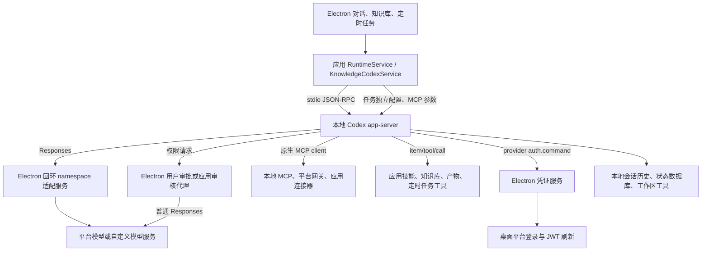

# repoverge 的 Codex 功能依赖与补丁精简计划

调研日期：2026-10-17。补丁目标版本：**Codex 0.163.0**。以下列出现有依赖、可选裁剪范围、补丁顺序和验收条件。启用的补丁以 [`patches/codex/series`](../patches/codex/series) 为准，构建与维护命令见 [README](../README.md)。

## 1. 结论与源码基线

repoverge 把 Codex 作为 Electron 管理的本地 Agent 引擎，主要依赖 `app-server` 的 stdio 协议、自定义 Responses provider、会话恢复、工具执行、MCP、动态工具、权限审批和上下文管理。适合优先评估的精简方向是：保留这条运行链路，缩减 CLI 入口，再拆除未接入产品的官方账号与云端功能。

三个依赖决定了补丁不能只按目录名称删除：

1. **账号管理和模型鉴权需要拆开。** repoverge 不调用 Codex 的账号登录 RPC，但平台 JWT 刷新依赖 provider 的 `auth.command`；在 0.163.0 中，这条能力仍使用 `codex-login` 内的 `AuthManager` 和 external bearer 实现。整个删除 `login` crate 会破坏平台模型。
2. **原生技能已被禁用，技能控制协议却是启动前提。** runner 每次开始任务前通过 `skills/list` 发现和验证技能，必要时调用 `skills/config/write` 关闭已启用项。直接删除这两个 RPC 会导致任务拒绝启动。
3. **只留下 app-server 入口仍不等于去掉官方服务。** 0.163.0 的 app-server 仍直接依赖账号、云配置、插件、遥测等模块，并在启动阶段装配相关组件；需要继续拆分初始化和依赖。

| 对象 | 调研基线 | 用途 |
| --- | --- | --- |
| repoverge | `/root/CodeProject/yisela/repoverge`，`refactor/electron-dev`，提交 `3380390a729a7c431e1b446a959a21022530a735` | 判断应用实际使用哪些 Codex 能力；本地分支与已有 `origin/refactor/electron-dev` 引用一致，未执行远端更新 |
| Codex 补丁基线 | tag `rust-v0.163.0`，提交 `83086188ae0614bd882818ff1aa23f3194962012` | 以下 Codex 源码定位均以此提交为准；workspace version 为 `0.163.0`，Rust toolchain 为 `1.95.0` |
| Codex 源码子模块 | `araceae-cli/codex`，gitlink 固定到 `83086188ae0614bd882818ff1aa23f3194962012` | 与源码锁保持一致；补丁在 `.worktrees/` 的独立工作树中应用 |
| 计划文档 | `araceae-cli/docs/repoverge-codex-feature-pruning-plan.md` | 记录依赖调研、选定范围与补丁职责；启用状态以 series 为准 |

repoverge 的打包配置尚未统一到目标版本：麒麟锁文件使用 `0.146.0`；Windows 构建脚本默认取 `latest`，要求稳定版不低于 `0.153.4`；macOS 脚本也默认取 `latest`。运行时还支持 `ARACEAE_CODEX_BIN` 覆盖，并可回退到 PATH。Git 跟踪的资源目录不包含实际 Codex 压缩包，因此这些配置不能证明已发布安装包中的版本。落地补丁前应把构建、打包和测试统一到 **0.163.0 + 明确的 patch 序列**。[R8][R9]

## 2. 实际运行链路与账号边界



`ProcessAgentRunner.start()` 在 `agentType === "codex-cli"` 时转交 `CodexAppServerRunner`，没有使用 Codex SDK 或 `codex exec` 执行普通对话。知识库作业也复用这一 runner。[R1][R6]

| “账号 / 云服务”的具体对象 | 当前行为 | 精简边界 |
| --- | --- | --- |
| Codex 的 ChatGPT OAuth、设备码登录、套餐、额度等 | 没有发现生产代码调用 `account/login/start`、`account/read`、`account/logout` 或账号额度 RPC | 可单独列为删除候选；需处理下面的无模型配置回退 |
| 未解析到 `modelProfile` 的原生认证回退 | `prepareCodexHome()` 会尝试把 `~/.codex/auth.json` 复制到任务目录；默认模型逻辑仍存在 | 不能宣称“完全不依赖原生账号”。移除账号能力时，应同步取消此回退，并为缺失模型配置提供明确错误，或另行保留一种显式认证方式 |
| repoverge 的平台登录、账号和租户 | 决定模型目录、JWT、MCP 权限和数据隔离；知识库明确要求登录上下文 | 属于应用业务，删除 Codex 官方账号不会移除这些功能 |
| 平台模型鉴权 | `model_providers.araceae.auth.command` 调用临时本机凭证服务；拒绝旧令牌后刷新 JWT | 保留平台模型时必须保留，不能以“删除 login”一起裁掉 |
| 自定义模型鉴权 | `env_key = "ARACEAE_MODEL_API_KEY"`，逐请求转发 Authorization | 可独立于 ChatGPT 账号存在；应保留自定义地址、环境变量密钥和 HTTP/TLS 客户端 |
| MCP / 第三方连接器认证 | 由平台 bearer、配置 header、应用连接器授权和本地代理等完成 | 与 ChatGPT 登录不同；删除 Codex 的账号界面不应破坏这些凭证路径 |
| 官方 Codex Cloud、远程控制、官方 Apps / 插件市场 | 未发现应用直接调用对应产品接口 | 可评估移除；仍需检查 Codex 内部启动任务和间接调用 |

平台和自定义模型都经过应用自建的 `responses-namespace-shim.ts`：它摊平 MCP / 子 Agent namespace 工具，恢复返回调用的 namespace，并固定实际模型与推理强度。它与 Codex 自带的 `responses-api-proxy` crate 是两套实现。删除后者不代表可以删除前者。[R3][R4]

若选择无需鉴权的本地模型，还需调整应用生成配置：当前无 `auth.command` 时固定写入 `env_key`，而 0.163.0 的 `ModelProviderInfo::api_key()` 会拒绝缺失或空白的环境变量。无鉴权 provider 应明确省略 `env_key` / `auth.command` 并使用不要求 OpenAI 认证的配置，不能只把 API Key 清空。[R1][C6]

## 3. 已接入的 Codex 功能

“已接入”表示有生产代码调用、配置或事件消费；不表示所有上游模型都支持，也不表示调研已执行运行验收。

| 能力 | repoverge 的具体用法 | 对裁剪的约束 |
| --- | --- | --- |
| 本地 app-server 与能力探测 | 启动前执行 `--version`、`app-server generate-json-schema --experimental --out ...`；运行时执行 `app-server --listen stdio://`，初始化携带 `experimentalApi: true` | 保留命令形状、schema 生成和双向 JSON-RPC；缺 schema 会令多项能力检查失败 [R1] |
| 会话、续聊和运行中追加指令 | `thread/start`、`thread/resume`、`turn/start`、`turn/steer`、`turn/interrupt`；无效会话会尝试重新创建；应用另有有界历史补充 | 保留原生 thread 状态、历史和中断语义；不能用每轮无状态请求替代 [R1][R5] |
| 流式输出与执行过程 | 消费 agent message、reasoning 摘要、plan、命令输出、文件 patch、工具结果、图片及 turn 完成/错误事件 | 精简时保留 UI 使用的通知；仅有最终文本不足以兼容 [R1] |
| 模型 provider 与 Responses | 写入 `model_provider="araceae"`、模型、`wire_api="responses"`、base URL、环境变量或凭证命令；不做 Chat Completions 转换 | 保留 SSE、工具调用、reasoning 历史、图片输入、错误与重试处理；仅支持 Chat Completions 的本地服务不能直接替换 [R2][R3][R4] |
| 上下文窗口与自动压缩 | 写入模型窗口及 `floor(window × 0.7)` 的压缩阈值；自定义 provider 使用普通 Responses 推理生成摘要 | 保留普通摘要压缩；它仍需要所选模型推理，不等于离线算法。官方专用远程压缩可另行评估 [R1][R11] |
| 应用指令与恢复时刷新 | 初始 thread 传 `developerInstructions`，恢复时通过 `turn/start.additionalContext` 的 `application` 条目刷新指令 | 不应把这些字段当成未使用的实验接口删除；恢复已有任务时有硬性能力检查 [R1][R5] |
| 原生工具执行与文件修改 | 消费 commandExecution、fileChange 等事件，配合 shell / unified exec、patch 和 sandbox | 保留执行、进程控制、文件编辑和安全边界；CLI 子命令 `apply` 与内部 `apply_patch` 执行能力需区分 [R1][C4] |
| 权限审批与沙箱 | `approvalPolicy`、`approvalsReviewer`、`sandbox` / `sandboxPolicy`；支持只读、工作区写入和完全访问；反向权限请求由应用回答 | 三项字段属于启动硬依赖；删除账号不应取消审批或扩大权限 [R1] |
| 应用侧智能审批 | 有 `modelProfile` 的普通任务使用应用审核代理和标准 `submit_approval_decision` 函数工具，再回复 Codex；无 profile 路径仍可选择原生 `auto_review` | 原生 Guardian / auto-review 可作为条件删除项；先处理原生回退，保留通用审批 RPC 和应用审核代理 [R1][R7] |
| MCP client | `-c mcp_servers.*` 配置本地 stdio、HTTP、header、环境变量 bearer 和平台网关；连接器通过应用 broker 接入原生 MCP | 保留 MCP 发现、调用、结果、资源与必要鉴权；不可因移除官方 Apps 而连带删除通用 MCP [R4][R5][R10] |
| MCP 启动状态与 elicitation | 读取 `mcpServer/startupStatus/updated`，等待已绑定服务状态；处理 `mcpServer/elicitation/request` 及会话内授权 | 缺失状态能力会影响就绪判断与降级提示；保留现有行为，验证失败服务不会被宣称已调用 [R1] |
| 动态工具 | `dynamicTools` 注册 `register_artifact`、`load_skill`、知识库工具，以及条件启用的定时任务创建/修改/停用工具；`item/tool/call` 回到应用执行 | 必须保留。应用技能、产物登记、知识库和定时任务都依赖这条通道 [R5][R6] |
| 知识库 Agent 循环与结构化输出 | `toolsOnly=true`，关闭 shell / unified exec / web search，注入应用工具与 `outputSchema`，必要时在同一 thread 续跑 | 保留动态工具、输出 schema、续聊和取消；不得因后台任务而误删整套 app-server [R6] |
| 原生 Default / Plan 模式及询问 | `collaborationMode/list` 获取 preset，`turn/start.collaborationMode` 明确切换；`item/tool/requestUserInput` 映射问题卡并回传答案 | 若保留 Plan，需保留两种协议；密文回答脱敏、停止后询问失效也属于现有契约 [R1] |
| Codex 原生子 Agent | namespace shim 成功时 `[agents].enabled=true`；不写显式子模型覆盖，继承父配置；shim 校正子任务模型；失败时关闭子 Agent | 已有主动配置，不能归为未使用；与应用平台绑定的远程 Agent MCP 工具也需区分 [R1][R4][R10] |
| 后台终端 | 调用 `thread/backgroundTerminals/list`、`terminate`、`clean`，跟踪跨轮进程与状态 | 保留该能力时必须保留会话复用和底层进程/PTY 管理，不能只留下前台 shell [R1] |
| 本地历史和状态迁移 | 任务独立 `CODEX_HOME` / `CODEX_SQLITE_HOME`；迁移 `state_*.sqlite` 的 `threads.rollout_path`；按账号、租户、品牌隔离 | 本地存储不是云同步；删除会话数据库会破坏恢复与迁移 [R8] |
| 图片输入、查看与生成结果 | 附件转 `localImage`；消费 imageGeneration 并落盘；`multimodal=false` 时关闭查看、生成、浏览器和计算机工具 | 图片输入与生成需分开裁剪；代码支持生成结果不证明所选 provider 能生成图片 [R1] |
| Web search | 自定义非平台模型及知识库 toolsOnly 禁用；平台模型路径不强制关闭，并消费搜索事件与来源 | 平台搜索不能直接认定未使用；是否保留需结合平台真实能力验收 [R1][R4] |
| 原生 Skills 控制 | 每轮列出并关闭原生技能、复查结果；禁用 `skill_search`；应用技能由独立服务注入/加载 | 禁用原生技能执行，控制协议保留空列表与明确的写入拒绝 [R1][R5] |
| Code mode host 及平台辅助文件 | Windows / macOS 的打包清单强制包含 `codex-code-mode-host`，Windows 还包含 sandbox setup、command runner 和 rg | 打包依赖已存在；模型实际是否使用 code mode 尚未运行验证，删除需同步变更清单和工具执行验收 [R9][C5] |

### 3.1 需要固定的协议表面

生产 runner 发起的 RPC 共以下 12 种，包含按条件调用的接口：

```text
initialize
thread/start
thread/resume
turn/start
turn/steer
turn/interrupt
collaborationMode/list
skills/list
skills/config/write
thread/backgroundTerminals/list
thread/backgroundTerminals/terminate
thread/backgroundTerminals/clean
```

反向调用至少保留 `item/tool/call`、`item/tool/requestUserInput`、`item/commandExecution/requestApproval`、`item/fileChange/requestApproval`、`item/permissions/requestApproval`、`mcpServer/elicitation/request`。runner 还兼容旧的 `execCommandApproval` / `applyPatchApproval` 别名；是否移除旧别名应在统一版本后单独决定。

Codex 0.163.0 的 `app-server-protocol/src/protocol/common.rs` 已声明上述主要接口；`v2/thread.rs` 和 `v2/turn.rs` 定义了 dynamic tools、输出 schema、审批、sandbox 和 application context 字段。这是静态协议存在性确认，尚不替代生成 schema 和实际握手验收。[C1]

回调使用原 JSON-RPC id 回复。动态工具返回 `contentItems` 和 `success`，结构化询问返回 `answers`，不同权限类型有不同响应结构。协议裁剪应验证行为与 payload，不能仅在 schema 中保留方法名称。

### 3.2 没有发现应用直接调用的入口

生产代码未发现直接使用 Codex 账号/额度 API、官方 Apps / 插件市场 RPC、远程控制 RPC、Realtime 会话 RPC、`model/list`，也未通过 Codex 的 TUI、`exec`、`review`、`cloud`、登录或插件管理 CLI 执行业务。

该结论不等于对应模块不会运行：模型元数据加载、原生技能发现、插件初始化、云配置和遥测可能由 Codex 内部路径触发。0.163.0 的 `app-server/src/lib.rs` 明确装配 AuthManager、cloud config loader、遥测、feedback 和 remote control 组件，`extensions.rs` 装配 MCP、插件、技能、搜索、图片、记忆和 Guardian 等扩展。[C2][C3]

## 4. 可删项、代价与方案选择

下面的风险等级描述修改与兼容风险，不代表已测得的体积收益。关闭 runtime feature、移除命令入口、从构建依赖中删除代码是三个不同层次；只有构建和产物测量才能证明体积减少。

| 候选项 | 建议处理 | 风险及配套修改 |
| --- | --- | --- |
| TUI、交互式会话选择器、补全、更新器、桌面启动入口 | 优先做轻量 CLI 入口，使目标不再依赖 `codex-tui` 等入口依赖 | 中；保留 app-server 启动、schema、`--version`、`-c` 和内部 helper 分发，不能只删除 clap 分支 [C4] |
| `codex exec`、CLI review、CLI cloud / cloud-tasks、CLI apply 等 | 可随入口精简移除，保留产品实际使用的底层能力 | 中；CLI review 与智能审批不是同一功能，CLI apply 与内部文件 patch 也不是同一功能 |
| ChatGPT 浏览器/设备码登录、账号信息/额度/套餐接口 | 从账号 RPC 和登录 UI 开始拆，随后剥离 OAuth、刷新、持久化等官方认证专用实现 | 高；处理无 profile 回退；保留 provider env key、external bearer、401 恢复和通用 HTTP/TLS，不能直接删除整个 `codex-login` [C6] |
| 其他未接入的内置认证/provider，如直接 Bedrock、agent identity | 在确认只保留自定义 Responses provider 的方案下继续拆 | 高；共享 enum 和鉴权抽象引用较广；保留通过自定义网关访问任意实际模型的能力 |
| Codex Cloud 任务和远程控制/daemon | 移除对应命令、RPC、启动分支及不再被引用的 client 依赖 | 中至高；不能误删用于本地 shell/sandbox 的 exec-server、线程状态或后台终端 |
| 官方云配置、账号云端策略读取 | 为目标构建提供仅本地的配置加载策略，取消官方云 loader 初始化 | 高；仍保留本地配置层、项目 trust、审批和沙箱策略；平台治理需求另行评估 |
| 官方 Apps / Connectors / 插件市场及自动安装 | 去除官方目录/安装/启动同步路径，保留应用原生 MCP 接入 | 中至高；repoverge 的连接器与资源市场是应用能力；不可按 `connector` 或 `plugin` 字样全删 [R10][C3] |
| 遥测上传、反馈上传、官方统计事件 | 先关闭发送与后台初始化，再拆 exporter/client 依赖；保留本地错误诊断 | 中；保留 UI token 用量，它来自 Responses shim 和审核代理；`disable_response_storage=true` 不能证明没有遥测或本地历史 |
| Codex 原生 Skills 的发现、内置技能、搜索 | 应用已有技能服务，可做更深裁剪 | 中；需要兼容技能隔离协议或同步升级 runner，详见第 5 节 |
| 原生 Guardian / auto-review | 已配置模型的对话走应用审核，可作为后续删除项 | 中至高；先取消/替代无 profile 原生审批回退；保留通用权限执行与审批通知兼容 |
| 官方远程模型目录与专用远程压缩 | 对自定义 provider 路径单独裁剪官方调用，保留本地元数据与普通摘要压缩 | 高；模型能力、上下文窗口、工具发现和子 Agent 仍需要元数据；“应用未调用 model/list”不足以删除 models-manager |
| Realtime、语音、远程 UI 等未接入能力 | 排除相应注册和依赖，并核对目标二进制是否原本包含它们 | 中；某 crate 不在目标依赖闭包时，删除源码不会缩小该二进制 |
| 长期记忆、hooks、goals 等没有明确应用入口的扩展 | 先显式禁用并检查默认启用和工具暴露，再决定是否删除 | 中；没有应用 RPC 调用不能证明模型不会自动触发。长期记忆与必要的会话历史不同 |
| 子 Agent | 可作为“单 Agent”配置选择，随后去掉对应工具与调度依赖 | 中至高；属于功能降级，需删除/调整多 Agent 指令。保留 MCP 时 namespace shim 仍有用途 |
| Plan / 结构化询问 | 可作为更小产品形态的选项 | 中；需同步取消 UI 模式和能力检查；Default 对话中的相关询问行为也需说明 |
| 图片生成、Web search、浏览器/计算机工具 | 按能力逐项选择，不能统一归为“无用云服务” | 中至高；图片输入/查看可独立保留；平台搜索路径已接入。Codex 浏览器能力与应用打包的 agent-browser / Chromium 也需分开 |
| Code mode / code-mode-host | 作为单独实验补丁，先验证普通工具调用可完整替代 | 高；0.163.0 的 `code_mode` 默认关闭，但 `code_mode_host` 默认开启；应用打包也强制要求 host，不能仅凭前一个开关删除 [C5] |
| 通用 MCP、动态工具、shell/patch、安全沙箱、本地历史 | 在保持当前 repoverge 功能的方案中保留 | 删除将影响核心产品行为；不适合混入账号/云服务清理补丁 |

### 4.1 可组合的产品范围

| 方案 | 保留范围 | 删除范围 | 应用侧影响 |
| --- | --- | --- | --- |
| A：仅精简入口 | 现有 app-server 功能 | TUI 与未用 CLI 产品入口 | 最小；仍需兼容命令和打包，内部官方账号/云依赖尚在 |
| B：去官方账号与云产品 | 平台/自定义模型、MCP、应用工具、审批、历史及已选能力 | ChatGPT 登录、官方 Cloud/远程控制、官方市场和选定上传能力 | 处理原生认证回退和共享依赖；平台登录/JWT/第三方联网仍保留 |
| C：进一步限定运行能力 | 在 B 上按需保留单 Agent、纯文本等能力 | 从子 Agent、Plan、图片生成、搜索、code mode 等逐项裁剪 | UI、指令、能力探测和打包需要一起调整 |
| D：完全离线产品 | 本地模型、本地文件和经选择的本地工具 | 外部模型、平台登录/目录/MCP、第三方 SaaS 等 | 超出 Codex 单仓补丁；需单独重构 repoverge 平台业务，知识库模型服务也需具备兼容 Responses 的端点 |

运行时采用 A 与 B，具体裁剪范围由第 5 节的补丁队列确定；C、D 保持独立选项，不属于该队列。

## 5. 补丁执行顺序

选定范围为移除官方账号与服务、保留 Agent 能力。repoverge 源码不在运行时补丁的修改范围内；Windows/macOS 下载适配独立进行。队列包含两项构建基础补丁和以下十四项功能补丁，各功能补丁保持一个 Git 提交。

| 补丁 | 职责 |
| --- | --- |
| `require-explicit-model-provider.patch` | 要求显式 provider 和 base URL，拒绝原生账号认证和缺失配置。 |
| `remove-cloud-config.patch` | 仅加载本地配置与策略，移除官方云配置 loader。 |
| `remove-remote-control.patch` | 移除远程控制 RPC、传输和后台任务；协议导出与实际注册表同步。 |
| `disable-native-skills.patch` | 禁用原生技能发现、安装、监视及注入，保留空列表和拒绝写入的控制协议。 |
| `remove-native-plugin-marketplace.patch` | 移除原生插件市场 RPC、启动同步和插件加载。 |
| `remove-official-apps.patch` | 移除官方 Apps RPC 和 hosted MCP 自动注册。 |
| `remove-cloud-history-notes.patch` | 移除云历史笔记扩展，关闭模型默认值对该功能的激活。 |
| `remove-cloud-git-attribution.patch` | 移除云 Git 归因扩展及其账号策略查询。 |
| `provider-scoped-model-catalog.patch` | 默认使用随包模型元数据，仅访问显式配置的 provider 模型目录。 |
| `provider-scoped-compaction.patch` | 默认通过所选模型生成摘要，远程压缩需显式声明能力。 |
| `remove-feedback-upload.patch` | 移除反馈 RPC 与上传模块，保留本地诊断。 |
| `remove-analytics-upload.patch` | 保留共享埋点接口，移除事件队列和发送任务。 |
| `remove-otel-exporters.patch` | 移除 OTLP/Statsig exporter、相关依赖和运行时重载任务。 |
| `remove-managed-account-flows.patch` | 移除原生登录、额度、账号查询和 workload identity；保留 provider 凭证刷新及独立 OAuth。 |

账号补丁排在末端，避免提前破坏云配置、插件、反馈等共享 `AuthManager` 的调用关系。`codex-login` 保留 provider 的 external bearer、401 恢复、gateway OAuth 和共享凭证类型；原生浏览器/设备码登录入口、账号 RPC、workload identity 激活和账号后台查询被移除。原生凭证文件和全局密钥不再作为模型配置回退。

补丁边界对应运行链路而不是源码目录。移除 RPC 时同时移除分发与启动装配；涉及依赖时同步 Cargo.toml / Cargo.lock，不升级无关外部包。原生技能禁用覆盖 host、executor、插件来源与扩展注册；`skills/list` 为空、写入拒绝，应用 `load_skill` 动态工具保留。

0.163.0 的生产协议生成器读取压缩的预生成快照。远程控制补丁增加由 Rust RPC 宏导出的有效方法表，对 JSON Schema 与 TypeScript 联合类型过滤；后续 RPC 裁剪沿用该机制，避免每项补丁重写同一二进制快照。解析器遇到不支持的快照结构应失败，不能静默导出过期接口。

每个运行时前缀使用 `--locked` 编译，再执行所需协议、累计删除项及 AIMock 用例；协议变化应恰好等于该前缀声明的删除集合。分发前从干净基线重放完整队列，构建全部平台 helper，并从独立解压目录执行制品验收。验收报告由脚本产生，不以编译成功替代运行测试。

## 6. Patch 管理方式

补丁维护仓库采用以下布局：

```text
araceae-cli/
  .gitmodules                    # 上游子模块 URL 与浅克隆配置
  codex/                         # 固定到源码锁提交的上游 Git 子模块
  .worktrees/                    # 从固定提交生成的工作树
  docs/
  patches/
    codex/
      series                     # 已选补丁的明确顺序
      metadata.json              # 补丁依赖、哈希和检查项
      align-workspace-lock.patch
      minimal-runtime-entrypoint.patch
      ...
  scripts/
    patches.py                   # prepare / apply / refresh / status / check
    build_runtime.py
    verify_runtime.py
    runtime_checks.py
    check_patch_prefixes.py
    network_checks.py
  manifests/
    runtime-source-lock.json
```

外层 `araceae-cli` 管理 docs、patches、源码锁、测试和构建脚本，并通过 gitlink 记录 `codex/` 的固定提交。上游源码内容保留在子模块，构建产物不纳入外层 Git。补丁使用稳定名称，版本与上游提交由源码锁和 Git 历史承载。`patches.py` 校验 gitlink 与源码锁一致，`prepare` 可初始化缺失的子模块，随后从锁定提交创建独立工作树。repoverge 的适配变更在其自身仓库维护，发行制品使用独立的构建身份供应用下载时核验。

使用 `git format-patch` 导出小提交，在干净的 0.163.0 工作树中按 `series` 使用 `git am` 顺序应用。每一步失败立即停止，记录当前补丁；不得忽略失败继续构建。`refresh` 只导出当前前缀末端的补丁，随后继续重放并从另一干净工作树验证整套队列。

0.163.0 的 Cargo.lock 将 160 个本地包记录为 `0.0.0`，与 workspace 的 `0.163.0` 不符。`align-workspace-lock.patch` 只对齐这些本地版本，不修改外部依赖；未裁剪基线与功能裁剪版本都使用这项构建修复，以支持 `--locked` 构建。

CI 至少区分“原版 0.163.0”和“选定补丁组合”；patch 清单与 repoverge 配套提交绑定。后续升级时，先验证未裁剪上游版本，再重放补丁和端到端验收。Cargo.lock、Bazel 描述和包资源清单按实际使用的构建系统同步维护。

不承诺固定的 MB、RSS 或启动时间收益。0.163.0 的 release profile 已使用 thin LTO，且打包前保留符号；比较时必须统一符号处理、目标平台及依赖版本，分别报告主二进制、辅助文件和完整 Electron 安装包。

## 7. 验收矩阵

业务测试使用端到端方式；涉及模型推理的场景使用 `@copilotkit/aimock`，连接真实的裁剪 Codex 二进制。以下矩阵列出 repoverge 集成验收入口；独立运行时验收由本仓库的 `tests/` 维护。fake app-server 适配测试可继续运行，但不能证明 Rust 裁剪后的行为。

| 场景 | 可复用的覆盖入口 | 通过条件 |
| --- | --- | --- |
| 命令与协议 | schema 探测、`codex-app-server-runner.test.ts`、runtime 打包测试 | 命令形状与所需 schema 可用；支持状态与实际行为一致；声明删除的能力明确拒绝 |
| 平台/自定义模型与凭证 | `codex-direct-model-e2e.test.ts`、`runtime-model-integration.test.ts` | 不依赖原生 auth.json；JWT 拒绝后刷新；API Key 不写入配置/日志/工具环境；切换身份不复用旧凭证 |
| MCP 与 namespace | `responses-namespace-shim-e2e.test.ts`、`runtime-instructions-e2e.test.ts` | 真实发现和调用绑定工具；namespace/历史还原；子 Agent 模型继承；失败服务状态正确 |
| 动态工具与知识库 | `knowledge-e2e.test.ts`、`aimock-e2e.test.ts` | 应用技能、知识库工具、产物与定时任务可调用；结构化输出与取消有效；后台任务不获得额外权限 |
| 权限与沙箱 | `codex-app-server-real-permission.test.ts`、`verify-codex-permissions.mjs` | 三种权限模式、拒绝、应用智能审批、越界 shell/patch 与 MCP 操作保持既有行为；Windows/Linux/macOS 分别验证 |
| 历史、压缩和状态迁移 | `codex-state-e2e.test.ts`、direct-model E2E、session/history 验证脚本 | 跨进程续聊、旧状态迁移、reasoning 历史重放和普通摘要压缩成功；不会因移除云能力丢失本地上下文 |
| 原生技能隔离 | runtime-instructions E2E；补充裁剪 runtime 的真实场景 | 原生技能不注入，应用技能仍可使用；恢复会话也不会绕过隔离 |
| Plan / 询问 / steer | runner 既有适配覆盖；补充真实二进制 + AIMock 场景 | Default/Plan 切换、同轮回答、密文脱敏、过期回答拒绝和运行中追加指令正常 |
| 后台终端与 helper | runner 既有覆盖；补充真实二进制 E2E | 跨轮存活、列出/停止/清理有效；中断单轮不误杀其他任务；patch/sandbox helper 能实际执行 |
| 可选搜索和多模态 | 现有 shim/runner 覆盖及选定能力的真实场景 | 保留项可调用；删除项不再对模型/UI 声明；图片输入、查看、生成结果分别验收 |
| 已删除官方服务 | 新增独立进程与网络观测 E2E | 启动、空闲、任务、401 和失败重试不访问已删除服务；必要模型/MCP 请求仍通过 |
| 跨平台制品 | Windows/macOS runtime archive 测试、麒麟 runtime-validation | 冷安装、品牌路径、辅助文件、签名/权限、重启恢复与卸载路径符合清单 |

repoverge 下载接入后的集成检查命令如下；`ARACEAE_CODEX_BIN` 必须指向待验收的目标二进制，不能落回系统 Codex。这些命令不属于独立运行时验收的执行结果。

```bash
# 在 repoverge 根目录执行，先指定裁剪产物的绝对路径。
export ARACEAE_CODEX_BIN=/absolute/path/to/patched/codex
pnpm exec tsc --noEmit
pnpm backend:test:e2e
pnpm exec vitest run --config vitest.config.ts tests/backend/codex-state-e2e.test.ts
pnpm electron:verify:codex-permissions
```

`electron:verify:codex-permissions` 会设置 `ARACEAE_REAL_CODEX_PERMISSION_ACCEPTANCE=1`；直接运行该测试文件而未设置开关会跳过，不能记为权限验收通过。history/prompt 等 bundled 验证脚本需先把裁剪产物装入对应 runtime 包，否则验证的是另一份二进制。独立运行时已包含 Plan、后台终端和删除功能的负向用例；repoverge 仍需验证这些行为经过应用适配层后的表现。

既有覆盖也需先校准：`codex-app-server-runner.test.ts:279` 仍断言缺少 MCP 启动状态协议时在启动前拒绝，而当前 runner 的 `#beginMcpStartupGate()` 返回空 gate，并在开始轮次前生成 `unverified` 状态。该用例定向执行失败，实际返回运行句柄而非拒绝启动；应用验收需要先明确契约并修正这一基线差异。独立运行时验收不能替代 repoverge 的整体验收。[R12]

## 8. 保留范围与集成边界

平台模型、自定义 Responses provider 和无需鉴权的本地 provider 均保留。子 Agent、Plan/结构化询问、通用 MCP/OAuth、动态工具、shell/patch、权限、沙箱、本地历史、后台终端、搜索、图片及 code-mode-host 不加入删除清单。普通摘要压缩使用所选模型；provider 显式声明的远程压缩能力仍可使用。

独立运行时的补丁重放、制品与模型验收由 `tests/`、`scripts/check_patch_prefixes.py` 和 `scripts/verify_runtime.py` 维护，报告输出到 `artifacts/`。Linux 本机结果与 Windows/macOS CI 结果分别记录，配置了 CI 不表示目标平台已通过。

repoverge 仍有原生 auth.json 拷贝和缺少 modelProfile 的原生回退逻辑。裁剪运行时在缺少显式 provider 时返回错误；应用下载接入应处理该错误，并统一安装包的版本、补丁摘要和哈希。原生技能列表为空时，现有技能隔离过程无需写入开关。

Electron 整体验收、真实厂商接口、第三方 MCP OAuth 的实际授权服务、平台签名、跨平台沙箱和性能需要各自的验证环境。AIMock 测试验证协议和运行行为，不证明外部服务支持所有模型工具。原生账号之外的共享认证类型仍可能留在依赖中；判断裁剪效果以注册入口、实际装配、依赖报告和运行观察共同为准。

## 9. 证据索引

repoverge 链接指向调研工作区，行号对应第 1 节记录的提交。Codex 源码路径均相对于 **0.163.0 的 `codex-rs/`**，不使用当前 main 的行号；可通过 `git -C codex show rust-v0.163.0:codex-rs/<路径>` 读取对应内容。

| 标记 | 源码或文档 | 主要证据 |
| --- | --- | --- |
| [R1] | [codex-app-server-runner.ts](/root/CodeProject/yisela/repoverge/electron/backend/runtime/codex-app-server-runner.ts:253) | `probeCodexCapabilities`；341 行 prepare home；547 行权限映射；618 行工具配置；1794 行启动；1948 行技能隔离；2035 行能力检查；2628 行反向请求；2836 行 thread/turn |
| [R2] | [model-runtime-service.ts](/root/CodeProject/yisela/repoverge/electron/backend/runtime/model-runtime-service.ts:38) | 平台与自定义模型解析、账号身份绑定及 JWT 刷新 |
| [R3] | [codex-provider-auth.ts](/root/CodeProject/yisela/repoverge/electron/backend/runtime/codex-provider-auth.ts:19) | 临时 loopback 凭证服务及 auth.command |
| [R4] | [responses-namespace-shim.ts](/root/CodeProject/yisela/repoverge/electron/backend/runtime/responses-namespace-shim.ts:25) | namespace 适配、模型固定、凭证逐请求传递、用量与搜索来源观测 |
| [R5] | [runtime-service.ts](/root/CodeProject/yisela/repoverge/electron/backend/runtime/runtime-service.ts:827) | 应用技能注入、MCP、应用指令、动态工具、定时任务和会话恢复 |
| [R6] | [knowledge-codex-service.ts](/root/CodeProject/yisela/repoverge/electron/backend/knowledge/knowledge-codex-service.ts:62)；[process-agent-runner.ts](/root/CodeProject/yisela/repoverge/electron/backend/runtime/process-agent-runner.ts:146) | 知识库 toolsOnly/outputSchema；Codex 走 app-server |
| [R7] | [codex-auto-review-agent.ts](/root/CodeProject/yisela/repoverge/electron/backend/runtime/codex-auto-review-agent.ts:379) | 应用侧标准 Responses 审核请求；runner 557 行决定是否启用 |
| [R8] | [codex-state-directories.ts](/root/CodeProject/yisela/repoverge/electron/backend/runtime/codex-state-directories.ts:23)；[runtime-platform.ts](/root/CodeProject/yisela/repoverge/electron/backend/runtime/runtime-platform.ts:117) | 本地状态与路径迁移、隔离；运行二进制解析优先级 |
| [R9] | [runtime-manifest.mjs](/root/CodeProject/yisela/repoverge/electron/runtime-manifest.mjs:23)；[build-codex.ps1](/root/CodeProject/yisela/repoverge/scripts/windows-runtime/build-codex.ps1:1)；[prepare-codex-runtime-macos.mjs](/root/CodeProject/yisela/repoverge/scripts/prepare-codex-runtime-macos.mjs:21)；[runtime.lock](/root/CodeProject/yisela/repoverge/packaging/kylin-amd64/runtime.lock:4) | 版本默认值、schema 检查、helper 清单、麒麟版本锁 |
| [R10] | [mcp-service.ts](/root/CodeProject/yisela/repoverge/electron/backend/mcp/mcp-service.ts:187)；[connector-mcp-broker.ts](/root/CodeProject/yisela/repoverge/electron/backend/connectors/connector-mcp-broker.ts:98) | stdio/HTTP 配置、平台 bearer、应用连接器桥接 |
| [R11] | [codex-model-provider.md](/root/CodeProject/yisela/repoverge/docs/architecture/codex-model-provider.md)；[AIMock 说明](/root/CodeProject/yisela/repoverge/tests/aimock/README.md) | 既有模型协议与测试约定；实际行为以生产代码和后续验收为准 |
| [R12] | [codex-app-server-runner.test.ts](/root/CodeProject/yisela/repoverge/tests/backend/codex-app-server-runner.test.ts:279) | 与 runner 1552 行、2862 行的 MCP 状态降级行为存在待验证差异 |
| [C1] | `app-server-protocol/src/protocol/common.rs:500`、`:552`、`:749`、`:894`、`:1042`、`:1057`、`:1212`、`:1797`、`:2015`；`app-server-protocol/src/protocol/v2/thread.rs:151`、`app-server-protocol/src/protocol/v2/turn.rs:213` | 请求、反向请求、通知、动态工具和 application context 声明 |
| [C2] | `app-server/src/lib.rs:551`、`:554`、`:638`、`:707`、`:864`；`app-server/src/message_processor.rs:1753` | AuthManager、cloud config、遥测、remote control 初始化和账号分发 |
| [C3] | `app-server/src/extensions.rs:50`；`app-server/src/request_processors/catalog_processor.rs:141`、`:159`、`:237` | Skills/MCP/插件/Guardian/搜索等扩展装配、技能控制和协作 preset |
| [C4] | `cli/Cargo.toml`；`app-server/Cargo.toml`；`cli/src/main.rs:140`、`:639`、`:1421`；`app-server/src/main.rs:31`；`arg0/src/lib.rs:59` | CLI 与 server 依赖、入口差异、schema 子命令和内部 helper 分发 |
| [C5] | `features/src/lib.rs:1161`、`:1179`；`code-mode-host/Cargo.toml`；`code-mode/Cargo.toml` | code_mode / code_mode_host 默认值、独立 host 与 runtime 依赖 |
| [C6] | `model-provider/src/auth.rs:184`；`login/src/auth/external_bearer.rs:18`；`login/src/lib.rs:37`；`protocol/src/config_types.rs:570`；`model-provider-info/src/lib.rs:480` | 通用 provider 凭证与 login 的共享实现、命令鉴权配置、env_key 非空校验 |

官方文档作为概念核对来源：已读取 [Codex App Server](https://learn.chatgpt.com/docs/app-server) 和 [Authentication](https://learn.chatgpt.com/docs/auth.md)，原 `developers.openai.com/codex/...` 地址访问时重定向至这些官方页面。它们说明 app-server 双向协议、按版本生成 schema，以及 ChatGPT/自定义 provider 认证的区别；在线文档会持续变化，0.163.0 的能力和补丁落点以固定提交源码为准。
